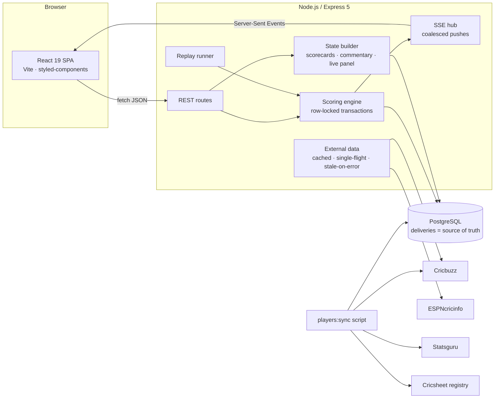

# ScorePulse 🏏

**A full-stack, ball-by-ball cricket scoring and match-analytics platform.** A scorer taps each delivery into a console; a scoring engine applies the Laws of Cricket inside a database transaction; and every open scorecard, commentary feed and live panel updates instantly over Server-Sent Events.

Around that core, ScorePulse carries real cricket data: 600+ player profiles with Test / ODI / T20I / IPL career records, current squads for 22 international and IPL sides, live ICC rankings, the real fixture calendar and cricket news.

> **Live demo:** _frontend link here_ · **API:** _backend link here_
>
> Built with React 19, Node.js / Express 5 and PostgreSQL, with raw SQL and no ORM.

---

## Contents

1. [What makes it different](#what-makes-it-different)
2. [Features](#features)
3. [Architecture](#architecture)
4. [Tech stack](#tech-stack)
5. [Data model](#data-model)
6. [Data pipelines](#data-pipelines)
7. [Engineering challenges and how they were solved](#engineering-challenges-and-how-they-were-solved)
8. [Correctness and testing](#correctness-and-testing)
9. [Security](#security)
10. [Performance](#performance)
11. [Project structure](#project-structure)
12. [Running locally](#running-locally)
13. [Deployment (free tier)](#deployment-free-tier)
14. [API reference](#api-reference)
15. [Limitations and roadmap](#limitations-and-roadmap)
16. [Data sources and credits](#data-sources-and-credits)

---

## What makes it different

Most cricket "clones" render scores fetched from someone else's API. ScorePulse **produces** the scores:

- **Deliveries are the only source of truth.** Totals, overs, strike rates, partnerships, fall of wickets, bowler figures, result text and commentary are all *derived* from the `deliveries` table on every request. Nothing is stored twice, so nothing can drift out of sync, and "undo" is just deleting a row.
- **One engine, three entry points.** The scorer console, the Cricsheet importer and the live replay runner all call the same engine functions, so a hand-scored match, an imported match and a replayed match obey identical rules.
- **Verified against real matches.** Twelve real matches from [Cricsheet](https://cricsheet.org) are imported *through* the engine, and an independent checker re-derives every batter's and bowler's line from the raw JSON: **524 checks**, all passing.
- **External data feeds the USP instead of replacing it.** The fixtures page shows the real calendar, but a fixture never links out: if ScorePulse covers it, it opens our own ball-by-ball page; if not, a **Score this match** button opens the scorer console pre-filled with that fixture.

---

## Features

### 🏟️ Scoring engine (`backend/src/scoring/engine.js`)
- Legal vs illegal deliveries; wides, no-balls, byes, leg byes and penalty runs; boundaries vs runs run
- Ball numbering like Cricinfo: extras repeat the ball number (`4.3`, `4.3`)
- Strike rotation on odd runs, byes and leg byes; batters change ends at the end of the over
- No consecutive overs by the same bowler; bowling quotas; new-batter / new-bowler prompts
- Innings end on all out, overs complete, target reached, declaration or forfeit
- Targets for chases and fourth innings, **DLS revisions**, **super overs** (2-wicket innings, batting order reversed), **follow-on**
- Results worked out automatically: by runs, wickets or an innings; ties, draws, no result
- Match lifecycle: `upcoming → toss → live ⇄ innings_break / delayed / stumps → completed / abandoned`
- **Undo the last ball**, which reopens a finished innings or match if needed
- Formats: T20, T10, ODI, List A, Test, first-class (multi-day, two innings each)

### 📡 Live updates
- Server-Sent Events push the full match state after every ball (`/api/matches/:id/stream`)
- Match lists get lightweight "something changed" pings (`/api/matches/stream`)
- Bursts (e.g. fast replays) are coalesced into one push per match every 60 ms
- Automatic fallback to polling if the stream drops; reconnects on its own

### 📝 Match centre
- Tabs: Commentary · Scorecard · Overs · Squads · Info
- Ball-by-ball commentary, newest first, paged, with optional scorer text per ball
- End-of-over summaries (runs, score, batters, bowler figures), innings breaks
- Wicket lines like `Kohli c Smith b Starc 45(30) [4s-5 6s-1]`
- Scorecards: dismissal text, R, B, 4s, 6s, SR; extras breakdown; did not bat; fall of wickets; bowling (O, M, R, W, NB, WD, ECO); partnerships
- Live panel: batters at the crease, current and previous bowler, partnership, last wicket, CRR / RRR, recent balls
- Scorecard names link to player profiles

### 🎙️ Scorer console (`/scorer`)
- Create a match, pick both XIs, record the toss, score ball by ball
- **Squad picker:** search the team's real squad (or every player); Enter adds the top hit; captain / keeper flags; batting order; new names allowed
- Rain delays, stumps, DLS target revisions, declarations, manual results, player of the match, substitutes and replacements
- **Replay any real Cricsheet match live** at 1 / 3 / 6 / 15 seconds per ball; replays survive server restarts
- Protected by a scorer key; locked entirely in production until one is configured

### 🧑‍🤝‍🧑 Players
- **624 players**: current squads of 12 international sides and all 10 IPL franchises (2026), plus domestic sides from imported matches
- Profiles: photo, role, batting / bowling style, date and place of birth, ICC rankings (current and best), debuts, recent form
- Career records for **Test, ODI, T20I and IPL**: batting (14 stats), bowling (14 stats) and fielding (9 stats)
- Every team a player has represented: national side, IPL, other leagues (BBL, PSL, SA20, The Hundred, CPL, ILT20, MLC, BPL, LPL ...) and domestic sides
- Players page: leaderboards (most international runs and wickets, IPL run-scorers, ICC top-ranked), team / role filters, search, six sort orders, URL-synced filters
- Profiles list the player's own matches on ScorePulse, with their figures in each

### 🏳️ Teams, 📊 Rankings, 📅 Fixtures, 📰 News
- **Teams:** flags and IPL crests, each side's current ICC rank per format, squad size and familiar faces; squad pages grouped by role with team totals
- **Rankings:** live ICC men's rankings (teams, batters, bowlers, all-rounders × Test / ODI / T20I) with a podium, trend arrows, and links to team pages and profiles
- **Fixtures:** the real calendar (upcoming by day with countdowns; live and recent results by series) with international / league / domestic / women filters; matches ScorePulse covers open here, others offer **Score this match**
- **News:** live ESPNcricinfo headlines on the home page in a magazine layout

### 🎨 Interface
- Custom design system on styled-components: glass surfaces, light / dark themes from CSS variables, a sliding segmented control, skeleton loaders, empty states
- Responsive from phone to desktop; offline banner; image fallbacks everywhere

---

## Architecture



**Scoring a ball, end to end**

1. The console `POST`s `/api/scoring/matches/:id/balls` with the scorer key.
2. The engine opens a transaction, `SELECT … FOR UPDATE` locks the match row, validates the delivery against the current state (who is on strike, whether the over is finished, whether the innings is over), inserts the delivery and any wicket, and moves the crease.
3. On commit, the SSE hub schedules a push for that match (coalescing anything else within 60 ms).
4. The state builder derives the full match view from the deliveries and streams it to every open page; list pages get a ping and refetch.

---

## Tech stack

| Layer | Technology | Notes |
|---|---|---|
| Frontend | **React 19**, **Vite 7**, **React Router 7** | Hooks only; routes keyed by id so state resets cleanly |
| Styling | **styled-components 6**, Sass | Theme-aware CSS variables, glass design system |
| Animation | lottie-react | Intro animation |
| Backend | **Node.js 20+**, **Express 5** | ES modules |
| Database | **PostgreSQL** (18 locally) via `pg` | Raw SQL, no ORM; JSON aggregation, lateral joins, generated columns, deferred composite FKs |
| Realtime | **Server-Sent Events** | One-way push; simpler than WebSockets for viewers |
| Security | helmet, express-rate-limit, CORS allowlist | Timing-safe key comparison, fail-closed scoring |
| Performance | compression (gzip) | Event streams excluded |
| Data | Cricsheet JSON, Cricbuzz, ESPNcricinfo Statsguru and RSS | Sync scripts plus cached live endpoints |
| Tooling | ESLint 9 (React 19 hooks rules), nodemon | |
| Hosting | Vercel (frontend), Render (API), Neon (Postgres) | All free tiers; `render.yaml` blueprint included |

---

## Data model

18 tables. Highlights:

```
matches 1─* match_players          (each side's XI and substitutes for that match)
matches 1─* innings 1─* deliveries 0..1─* wickets 1─* wicket_fielders
players 1─* player_batting / player_bowling / player_fielding   (one row per format)
players *─* teams via player_teams                              (current squads)
players 1─* player_affiliations                                 (every side ever represented)
match_players.player_id → players                               (scorecards link to profiles)
```

Design decisions:
- **Derived, not stored:** an `innings_totals` view and the state builder compute everything from deliveries. `deliveries.runs_total`, `runs_extras` and `is_legal` are **generated columns**, so they can't disagree with their inputs.
- **Integrity in the database, not just the app:**
  - composite foreign keys `(player_id, match_id)` guarantee a batter or bowler belongs to *that* match;
  - they're `DEFERRABLE INITIALLY DEFERRED`, so an innings and its crease can be created in one transaction;
  - a **partial unique index** allows at most one innings in progress per match;
  - `CHECK` constraints: a wide can't also be a no-ball or have bat runs, byes and leg byes are exclusive, boundaries are 4 or 6, and the toss winner must be one of the two teams.
- **Stable external IDs:** players carry `cricbuzz_id`, `cricinfo_id` and `cricsheet_id`, so syncs update rows in place and profile URLs never change.
- **Migrations** in `backend/db/migrations`, applied once each by `npm run db:migrate`.

---

## Data pipelines

### 1. Real matches: Cricsheet → engine
`npm run import:cricsheet` reads the JSON files in `MatchesData/` and replays every delivery **through the engine**, the same code path as a human scorer. The importer then compares every innings total with the raw file. Replays (`/scorer` → *Replay a real match*) feed the same files ball by ball on a timer, with progress kept in the database so they resume after a restart.

### 2. Players: three sources, one identity (`npm run players:sync`)
| Step | Source | What it gives |
|---|---|---|
| Squads | Cricbuzz team pages | Current squads for 22 sides |
| Profiles | Cricbuzz profile pages (embedded Next.js data) | Bio, styles, image, rankings, debuts, recent form, all teams, batting and bowling for Test / ODI / T20I / IPL |
| Identity | ESPNcricinfo Statsguru search | Each player's Cricinfo id, matched on name, country and per-format match counts |
| Fielding | Statsguru records | Catches, stumpings, keeper vs fielder, best innings, span (international and IPL) |
| Scorecard links | Cricsheet people register | Maps imported match players to Cricinfo ids, and so to profiles |

- **Snapshot:** the result is written to `backend/db/seed/players.json` (~1.9 MB, committed), so `npm run players:load` rebuilds the tables **offline**.
- **Cache:** HTTP responses are cached in `backend/.cache`, so a re-sync takes seconds and is polite to the sources.

### 3. Live context: fixtures, rankings, news
Express endpoints read Cricbuzz / ESPNcricinfo on demand behind an in-memory cache:
- **Freshness:** results 2 min, schedule 30 min, rankings 6 h, news 10 min.
- **Single-flight:** however many visitors arrive at once, only one request goes out.
- **Stale-on-error:** if a source fails, the last good copy is served.
- **Graceful hiding:** if there has never been a good copy, the section hides itself or shows an "unavailable" state.

---

## Engineering challenges and how they were solved

**1. Keeping scores correct under every edge case of the Laws.**
*Problem:* cricket scoring is full of exceptions. A wide isn't a ball faced, but a no-ball is. Leg byes rotate strike but aren't charged to the bowler. A run-out can happen at either end after a completed run. Super overs reverse the batting order.
*Solution:* a pure `rules.js` module plus an engine that validates every delivery against the live state inside a transaction. The state builder then derives every figure from raw deliveries.
*Result:* 37 hand-scored rule checks pass, and 524 scorecard checks across 12 real matches agree with Cricsheet exactly.

**2. Concurrent writes from more than one scorer or a replay.**
*Problem:* two requests scoring the same match at once could double-count a ball or corrupt the crease.
*Solution:* every engine write runs in one transaction holding a `SELECT … FOR UPDATE` row lock on the match. Deferred composite FKs let a ball, a wicket and the new crease commit atomically.

**3. Live updates without hammering the database.**
*Problem:* a 1-second replay with many viewers would rebuild and push the whole match on every ball.
*Solution:* an SSE hub that coalesces pushes per match (60 ms window) and builds the payload once for all subscribers. List pages receive tiny pings and refetch, debounced. The client falls back to polling if the stream drops.

**4. One player, three databases, no shared id.**
*Problem:* Cricbuzz, ESPNcricinfo and Cricsheet each use their own player ids. The Cricsheet register knows Cricinfo ids but almost no Cricbuzz ids (50 of 18k).
*Solution:* a scoring matcher over Statsguru search results:
- name and known-as name, first-name bonus, apostrophe restoration (`ORourke` → `O'Rourke`);
- country, including dual nationals listed as `AUS/ENG`;
- per-format match counts within tolerance.

A second pass uses surname and country from imported scorecards.
*Result:* 482 of 495 Cricbuzz players (97%) matched to Cricinfo, with zero duplicates. The rest keep full profiles and miss only fielding. 282 of 290 scorecard players link to profiles, up from 85 with exact-name matching.

**5. Reading modern sites without an API.**
*Problem:* Cricbuzz pages are Next.js apps whose HTML is mostly empty.
*Solution:* decode the streamed React Server Components payload (`self.__next_f.push` chunks) and extract typed JSON with a string-aware bracket matcher.
*Lesson:* the fixtures page first showed only 10 results because the first JSON block on the page was a header ticker. Reading *every* block and deduping by match id gave 65.

**6. Keeping the USP when showing other people's fixtures.**
*Problem:* linking fixtures to Cricbuzz would send viewers away from the ball-by-ball experience.
*Solution:* fixtures never link out. The API matches each one to ScorePulse matches (same two teams within a day) and either links to our match page or returns a **prefill** payload. The scorer console turns that payload into a ready-to-create match. Tested end to end with a live Test.

**7. Third-party failures and hotlink blocking.**
*Problem:* external sites rate-limit, change, or refuse embedded requests. The IPL site served crests to `curl` but browsers got `ERR_BLOCKED_BY_ORB`.
*Solution:* single-flight, stale-on-error caching; graceful empty states; and self-hosting the ten IPL crests (216 KB).

**8. A database that couldn't be rebuilt from the repo.**
*Problem:* player data was hand-entered and CSV-based, and couldn't be reproduced.
*Solution:* migration `002_players.sql` plus a committed snapshot and an idempotent loader that upserts by external ids (stable URLs), removes stale rows and relinks scorecards in one transaction.

**9. Production hardening on free hosting.**
*Problem:* a public demo must not be writable by strangers, and free hosts sleep.
*Solution:*
- CORS allowlist with wildcard preview domains, `helmet`, and tiered rate limits;
- 100 KB body cap and timing-safe scorer-key comparison;
- scoring that **fails closed** in production without a key;
- TLS to Postgres and graceful `SIGTERM` shutdown;
- a health route that deliberately doesn't wake a scale-to-zero database.

`npm audit` found a critical `proxy-addr` IP-spoofing advisory, which matters precisely once `trust proxy` is on. It's patched: production dependencies report 0 vulnerabilities.

**10. Payload size.**
*Problem:* the players list is 624 rich records.
*Solution:* SQL-side aggregation (`json_object_agg` per format) and gzip, which cut it from 401 KB to 66 KB. Server-Sent Events are excluded from compression so they're never buffered.

---

## Correctness and testing

```bash
cd backend
npm test                 # both suites below
npm run test:engine      # 37 rule checks: scores short matches by hand through the engine
npm run verify           # 524 checks: every imported scorecard vs. lines re-derived from raw Cricsheet JSON
```

- The engine suite covers strike rotation, wides and no-balls, leg byes, end-of-over handling, wickets and dismissal text, undo, run-out ends, innings end, targets, chase status text, results and super overs.
- The verifier works independently of the app's code. It re-derives each batter's line (R, B, 4s, 6s) and each bowler's (balls, runs, wickets) straight from the raw JSON, then checks that every innings adds up: batting + extras = total, one fall-of-wicket entry per wicket, partnerships sum to the total.
- The frontend lints clean under ESLint 9 with React 19's stricter hooks rules, and builds with Vite.

---

## Security

| Concern | Measure |
|---|---|
| Unauthorised scoring | `SCORER_KEY` required on `/api/scoring` (timing-safe compare); **locked in production if unset** |
| Cross-site use of the API | `CORS_ORIGIN` allowlist (supports `https://app-*.vercel.app` preview patterns) |
| Abuse / scraping | Rate limits per IP: 900 per 5 min for reads, 300 for scoring, 120 for endpoints backed by third parties |
| Headers | `helmet` defaults (HSTS, no-sniff, frame protection, no `X-Powered-By`) |
| Payloads | JSON bodies capped at 100 KB; the engine validates every delivery |
| Database | TLS (`DATABASE_URL`), parameterised queries throughout, secrets only in environment variables |
| Errors | 5xx responses hide internals; rule violations return 400 / 409 with scorer-friendly text |
| Dependencies | Production dependencies audit clean (backend and frontend) |

---

## Performance

- **gzip:** about 6× smaller JSON (`/api/players` 401 KB → 66 KB).
- **External data:** cached in memory with single-flight refresh; a cached news response returns in about 40 ms.
- **SQL does the heavy lifting:** per-format JSON aggregation, `LATERAL` joins for per-match figures, indexes on hot paths (`deliveries (innings_id, seq)`, `matches (status)`, `player_teams (team_id)`).
- **SSE coalescing:** one payload build per match per burst, however many viewers are watching.
- **Lazy images:** with initials or monogram fallbacks, so slow or broken images never break a layout.

---

## Project structure

```
ScorePulse/
├── backend/
│   ├── db/migrations/        001_live_scoring.sql, 002_players.sql
│   ├── db/seed/players.json  player snapshot (offline seed)
│   ├── scripts/              migrate, import-cricsheet, test-engine, verify-scorecards
│   │   └── players/          fetch.js (web → snapshot), load.js (snapshot → DB), sources.js, teams.js
│   └── src/
│       ├── app.js, server.js middleware, routes, graceful shutdown
│       ├── scoring/          engine, rules, state builder, SSE hub, replays, Cricsheet adapter, text
│       ├── controllers/      matches, scoring, players, teams, rankings, fixtures, news
│       └── lib/              cricbuzz.js (decode + cache), teamLogos.js
├── frontend/
│   ├── public/logos/ipl/     self-hosted IPL crests
│   └── src/
│       ├── Pages/            Home, Fixtures, Teams, TeamDetails, Players, PlayerProfile, Rankings, MatchDetails, Scorer, ScorerConsole …
│       ├── Components/       match centre, scorer console, PlayerCard, NewsSection …
│       ├── hooks/            useLiveMatch (SSE + polling), useMatchList, useAction
│       └── ui/               design-system kit, player components and stats helpers
├── MatchesData/              12 real Cricsheet matches
└── render.yaml               Render blueprint for the API
```

About 14,000 lines of hand-written JavaScript and SQL (backend ~5.5k across 42 files, frontend ~8.8k across 45).

---

## Running locally

Prerequisites: Node 20+, PostgreSQL.

```bash
# backend
cd backend
cp .env.example .env          # fill in DB_PASSWORD (SCORER_KEY optional locally)
npm install
npm run db:migrate            # applies migrations not yet applied
npm run import:cricsheet      # imports every match in MatchesData/ through the engine
npm run players:load          # players, squads and career records from db/seed/players.json
npm run dev                   # http://localhost:8000

# frontend
cd frontend
npm install
npm run dev                   # http://localhost:5173 (set VITE_API_URL if the API isn't on :8000)
```

- `npm run players:sync` re-fetches squads and records from the web, then reloads. Responses are cached in `backend/.cache`.
- The `teams`, `venues` and `tournaments` tables predate the migrations, so an existing database is the easiest starting point (see [Deployment](#deployment-free-tier) for copying one).

---

## Deployment (free tier)

| Part | Host | Why |
|---|---|---|
| Frontend | **Vercel** | Static SPA; `vercel.json` rewrites every path to `index.html` |
| API | **Render** free web service | A long-running process for Server-Sent Events, replay timers and in-memory caches (serverless functions can't hold these) |
| Database | **Neon** free Postgres | Scales to zero and wakes in under a second; TLS |

**1. Database → Neon.** Create a project (pick the newest Postgres version offered), copy its connection string, then copy your local database. Plain SQL is the most portable format across versions:
```bash
pg_dump --no-owner --no-privileges -d scorepulse -f scorepulse.sql
psql "postgresql://…neon.tech/neondb?sslmode=require" -f scorepulse.sql
```
If a dump from a newer local Postgres warns about unknown settings such as `transaction_timeout`, those lines are harmless.

**2. API → Render.** *New → Blueprint* → pick this repo (`render.yaml` does the rest), then fill in:
- `DATABASE_URL`: the Neon string
- `SCORER_KEY`: a long random string, e.g. `openssl rand -hex 24`
- `CORS_ORIGIN`: e.g. `https://scorepulse.vercel.app,https://scorepulse-*.vercel.app`

Pick the same region as the database.

**3. Frontend → Vercel.** Set `VITE_API_URL=https://<service>.onrender.com` under *Settings → Environment Variables*, then **redeploy**: Vite bakes it in at build time.

**4. Keep it awake.** Render's free tier sleeps after ~15 idle minutes, and the first visitor then waits 30–60 s. A free pinger (cron-job.org, UptimeRobot) hitting `/api/health` every 10 minutes prevents this. One service fits in the free 750 hours a month. The health route doesn't touch the database, so Neon still scales to zero.

**5. Check.** Open the site in a private window. The browser's network tab should show calls to the Render URL with no CORS errors. Start a replay so the home page shows a live match.

> Cricbuzz and ESPNcricinfo can refuse requests from cloud IP ranges. If they do, Fixtures / Rankings / News show their "unavailable" state, and everything else keeps working: players come from the database, and matches from the engine.

---

## API reference

| Method | Endpoint | Description |
|---|---|---|
| GET | `/api/health` | Liveness |
| GET | `/api/matches?status=live\|upcoming\|completed` | Match cards |
| GET | `/api/matches/recent` | Live first, then latest results |
| GET | `/api/matches/:id` | Full match state: info, live panel, scorecards, latest commentary |
| GET | `/api/matches/:id/scorecard` | Scorecards only |
| GET | `/api/matches/:id/commentary?innings=&before=&limit=` | Paged commentary |
| GET | `/api/matches/:id/stream`, `/api/matches/stream` | Server-Sent Events |
| GET | `/api/players?team=` | Player cards with per-format summaries |
| GET | `/api/players/:id` | Profile, records, squads, affiliations, ScorePulse appearances |
| GET | `/api/teams`, `/api/teams/:id/players` | Teams with logos, squad sizes and faces; a squad |
| GET | `/api/rankings` | ICC team and player rankings (6 h cache) |
| GET | `/api/fixtures?type=upcoming\|results` | Real calendar, linked to ScorePulse matches, with scorer prefills |
| GET | `/api/news?limit=` | Cricket headlines (10 min cache) |
| * | `/api/scoring/...` | Scorer console: matches, squads, toss, balls, undo, innings, status, results, replays (requires `x-scorer-key`) |

---

## Limitations and roadmap

Tracked in detail in [`RECOMMENDATIONS.md`](RECOMMENDATIONS.md). The main open items:
- **Scorer accounts:** replace the single shared key with users and roles, and record who scored each ball.
- **Base schema migration** for `teams`, `venues` and `tournaments`, so a database builds from nothing.
- **Real tournaments and points tables** from match results (net run rate from `innings_totals`); these pages still use sample data.
- **Horizontal scaling:** the SSE hub and replay timers live in one process; Postgres `LISTEN/NOTIFY` would share them across instances.
- **Scraped sources** can change shape; their parsers are isolated in `src/lib/cricbuzz.js` and `scripts/players/sources.js`.
- **CI:** GitHub Actions running migrations, the import, both test suites, lint and build; Playwright end-to-end tests for the scorer.
- **Charts and extras:** worm and Manhattan charts, win probability, keyboard shortcuts for scoring, editing any past ball.

---

## Data sources and credits

- Ball-by-ball match data: [Cricsheet](https://cricsheet.org) (Open Data Commons Attribution License)
- Player profiles, squads, images, fixtures and rankings: [Cricbuzz](https://www.cricbuzz.com)
- Fielding records and player identity: [ESPNcricinfo Statsguru](https://stats.espncricinfo.com)
- News: [ESPNcricinfo RSS](https://www.espncricinfo.com/rss)
- IPL crests: [iplt20.com](https://www.iplt20.com)

ScorePulse is a non-commercial portfolio project. Team names, logos and player images belong to their respective owners.

---

## Author

Built and maintained by **Himanshu Aggarwal**.
